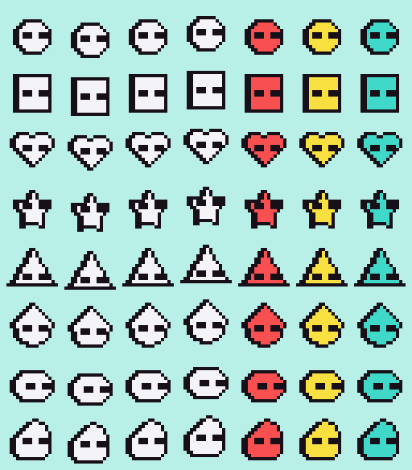

# Character Selection

## Flow
Title ("GROK BOT", PRESS START) → Picker → Level 1 (Green Hills, then High Ridge).

Everything below is generated by `scripts/build_level1.py`; edit the script and rerun it rather than editing the scenes in GB Studio.

`docs/shapes-sheet.png` shows each shape's four frames (idle, walk A, walk B, jump) in the white palette, then the idle frame in red, yellow, and teal.

## Style (locked Grok Imagine style)
- One solid fill (every body pixel is the same palette entry), a thin 1 px black outline, no shade band.
- Two short, thick, horizontal black oval eyes (3x2 px each), mirrored about the sprite's centre line.
- No mouth, eye whites, pupils, or antenna.

## Variables
Both persist through pits, Game Over, and a clear. Neither is reset by Level 1.

| Variable | Id | Values |
|----------|----|--------|
| `player_shape` | 6 | 0 circle (default), 1 square, 2 heart, 3 star, 4 triangle, 5 teardrop, 6 oval, 7 blob |
| `player_color` | 7 | 0 white (default), 1 red, 2 yellow, 3 teal |

## Picker controls
- Right: `player_shape` + 1, wrapping 7 → 0.
- Left: `player_shape` − 1, wrapping 0 → 7.
- Up: `player_color` + 1, wrapping 3 → 0. Down: − 1, wrapping 0 → 3.
- A or Start: go to Level 1.

Each press updates the preview actor (`Actor: Set Sprite` for the shape, `Palette: Set Sprite` slot 0 for the color).

## Sprites
| Shape | File |
|-------|------|
| 0 circle | `assets/sprites/player_grok.png` (also the project's default player sprite) |
| 1 square | `assets/sprites/player_grok_square.png` |
| 2 heart | `assets/sprites/player_heart.png` |
| 3 star | `assets/sprites/player_star.png` |
| 4 triangle | `assets/sprites/player_triangle.png` |
| 5 teardrop | `assets/sprites/player_teardrop.png` |
| 6 oval | `assets/sprites/player_oval.png` |
| 7 blob | `assets/sprites/player_blob.png` |

- One PNG per shape: a 64x16 indexed (palette-mode) PNG, four 16x16 frames, each built from two 8x16 tiles (8 tiles per sheet, 6 unique after GB Studio drops duplicates, since walk B repeats idle).
- PNG palette: index 0 transparent, 1 fill (white), 2 outline (gray), 3 eyes (black). GB Studio maps these to sprite colors 1, 2, 3 by green channel.
- **Sprite palette order.** A GB Studio sprite palette only shows palette colors 0, 1 and 3: sprite color 1 → palette color 0, color 2 → palette color 1, color 3 → palette color 3 (`getSpritePalette` in `compileData.ts`, `paletteSetSprite` in `scriptBuilder.ts`). Palette color 2 is never drawn on sprites. Before this fix every picker palette had F8F8F8 in color 0, so the fill stayed white and only the old lower shade band took the chosen color.
- `platform_player` animation type with Flip Left on: there are no left-facing PNGs; GB Studio mirrors the right-facing frames.
- The player is one 16x16 metasprite = 2 hardware sprites (8x16 mode) on any scanline.

## Applying the choice in Level 1
Each Level 1 scene's init runs `If player_shape == N → Player: Set Sprite` for N = 1..7 (0 keeps the default circle), then sets sprite palette slot 0 from `player_color`.

## Budgets
- Sprite palettes: color is a swap of slot 0 between Grok Bot, Grok Red, Grok Yellow, and Grok Teal (and their "Power" twins with a glowing outline after a silicon chip). Level scenes use 6 of the 8 GBC sprite palette slots.
- Tiles: 8 sheets x 8 tiles = 64 8x16 tiles (128 8x8 tiles) in ROM. VRAM is not 64 tiles: for an actor whose sprite is changed by script, GB Studio reserves one slot the size of the largest sheet it can take (`actorsExclusiveLookup` in `src/lib/compiler/compileData.ts`), and `Set Sprite` loads the chosen sheet into it. So the player and the picker preview each hold one sheet (8 tiles) at a time.

## Colors
| Index | Palette | Palette colors 0-3 (fill, outline, unused, eyes) |
|-------|---------|------|
| 0 | Grok Bot | F4F4F8, 181018, F4F4F8, 181018 |
| 1 | Grok Red | F85050, 181018, F85050, 181018 |
| 2 | Grok Yellow | F8E040, 181018, F8E040, 181018 |
| 3 | Grok Teal | 40D8C8, 181018, 40D8C8, 181018 |

## Not done yet
Cloud, diamond, plus, flower, pentagon, and the other colors from the original character-select design (brown, orange, green, blue, purple, pink, gray).
